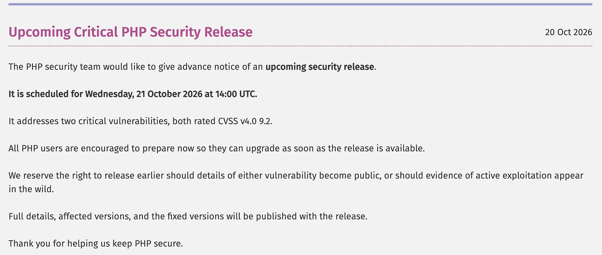
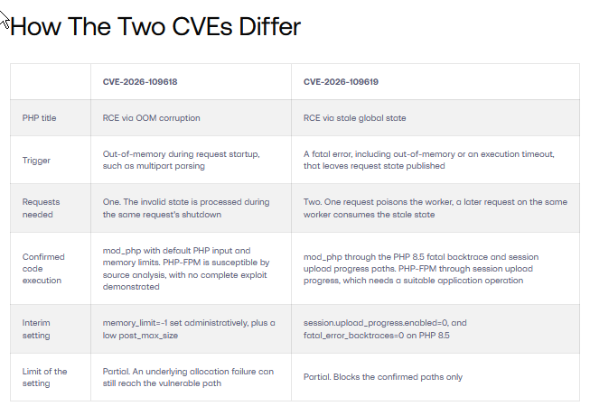
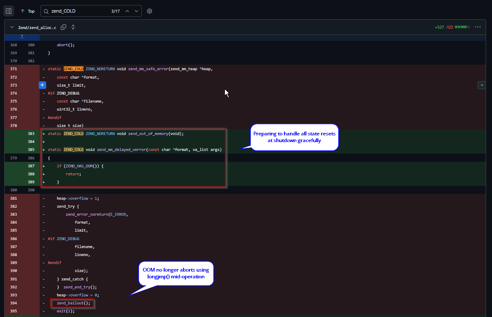
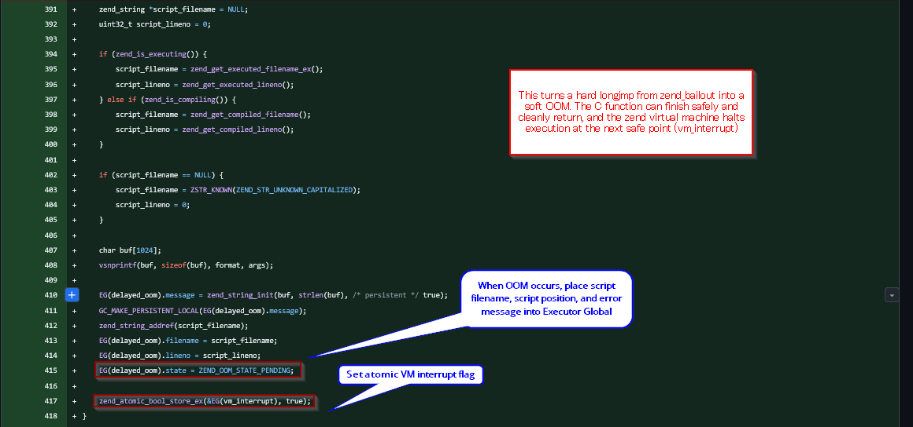
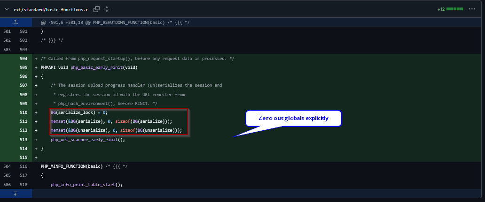
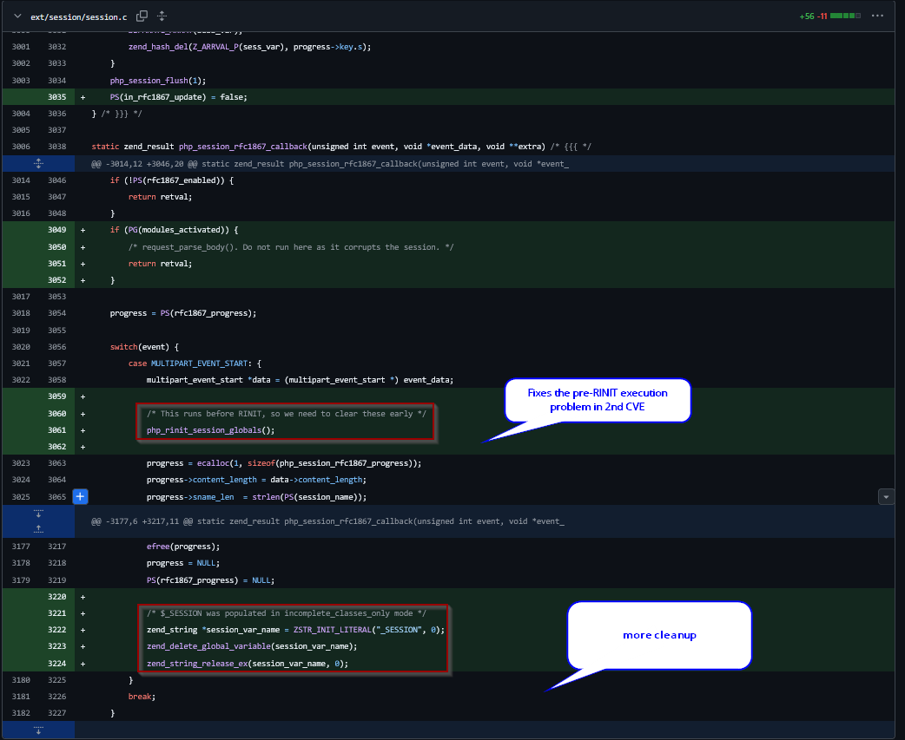
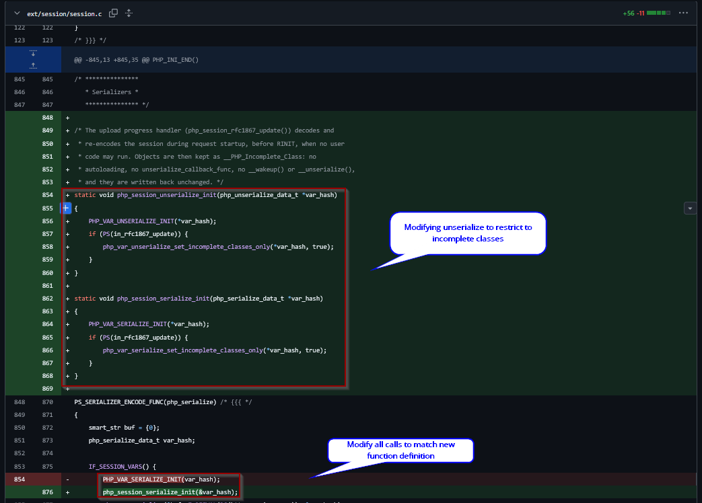

# PHP2Shell (CVE-2026-109618 & CVE-2026-109619) - Primitives, Patch Analysis, Detection Engineering

## Overview

On October 20th 2026, PHP announced an emergency security advisory addressing two CVSS 9.2 Critical vulnerabilities (**CVE-2026-109618** and **CVE-2026-109619**), collectively dubbed **PHP2Shell**. They disclosed a patch would be released October 21st 2026, less than 24 hours later.

<figure><figcaption><p>PHP Advisory</p></figcaption></figure>

The two CVEs affect multiple versions of `php` dating back to March 1st 2012; the release of 5.4.0 which introduced the vulnerable `session.upload_progress` feature.

| **Affected PHP Versions:**                    | **Vulnerable Configurations:**                                                                                                                |
| --------------------------------------------- | --------------------------------------------------------------------------------------------------------------------------------------------- |
| <p> <code>5.4.0 through 8.5.11</code><br></p> | <p> <code>session.upload_progress.enabled=On</code> (default)<br> <code>multipart uploads accepted</code><br> <code>Apache mod_php</code></p> |

**Why the high CVSS?:** Both CVEs carry a CVSS 4.0 rating of 9.2 marking them as critical. Because PHP parses multipart data and handles early configuration/session hooks _before_ application code runs, even hardened, vulnerability-free PHP applications are exposed and still vulnerable to unauthenticated RCE via the underlying PHP.

**Pre-authentication vulnerable PHP applications**

```
- WordPress 7.1.2
- Drupal 11.4.3
- Joomla 6.1.4
- MediaWiki 1.46.2
- Roundcube 1.7.4
- Magento 2.4.9
- phpMyAdmin 5.2.3
- Nextcloud 35.0.1
- Laravel 13.11
- Symfony 8.1
- WHMCS
```

In this article I will

* Investigate the exploit primitive of each CVE
* Perform patch analysis of the vulnerable `php-src/Zend` source code
* Review the current public POCs
* Recommend some detections and mitigations
* Close with some final hardening and remediation recommendations.

## Exploit Primitives: How PHP Breaks Its Own Memory Contract

Both CVEs are classified as `CWE-824: Access of Uninitialized Pointer` and `CWE-416: Use-After-Free`

### [**CVE-2026-109618**](https://github.com/php/php-src/security/advisories/GHSA-w8hw-w9fx-j79w)**: RCE via OOM Corruption**

The first vulnerability can effectively be seen as an out-of-memory (OOM) which leads into a use-after-free (UAF) during shutdown procedures in `mod_php`.

#### **Step 1. Trigger OOM on demand**

Triggering an OOM was found to be possible by exceeding the `memory_limit` while remaining under the `post_max_size` via sending multipart requests with no meaningful declared length (lacking `Content-Length`) or by sending multipart requests with the `filename` nested (file\[a]\[b]\[c]).

These formatted requests exhaust the `memory_limit` by fooling the process into accepting more data than it should. When this occurs, the `zend_bailout()` is taken which takes a `longjmp()` to a different section of code, skipping proper cleanup and leaving corrupted data in the buffer. In the words of Calif, "Now that we can cause OOM/fatal on demand, the question is what can we interrupt that leaves the process in an exploitable state?"

#### **Step 2: Corrupt HashTable state Mid-Allocation**

With the OOM triggered, the next step was to find a way for another part of the code to reuse the same buffer such as a UAF which will be interpreted as a pointer. By finding a UAF, we can use the corrupted buffer to groom the heap; We can craft a payload to direct code execution.

When PHP registers request variables (`$_POST` or `$_FILES`), it inserts entries into a `HashTable` via `_zend_hash_str_add_or_update_i()` in `Zend/zend_hash.c`. Inspecting the allocation order in the entry logic reveals the flaw ...

_**Zend/zend\_hash.c (\_zend\_hash\_str\_add\_or\_update\_i)**_

```c
idx = ht->nNumUsed++;
ht->nNumOfElements++;

/* 1. Both nNumUsed and nNumOfElements are incremented BEFORE initializing the new Bucket. The uninitialized Bucket at arData[idx] is now visible to teardown routines. */

p = ht->arData + idx;
p->key = zend_string_init(str, len, persistent); 

/* 2. Fallible allocation: may hit OOM and call zend_bailout()! */

/* 3. If zend_string_init() triggers an OOM bailout, execution jumps out via longjmp(). The key, hash, and zval assignments below are completely skipped! */
p->h = ZSTR_H(p->key) = h;
ZVAL_COPY_VALUE(&p->val, pData);
```

The `nNumUsed` counter is incremented regardless of if a valid allocation was finished. This leaves stale, attacker-groomed heap bytes inside `ht->arData[idx]` which can later be used during a separate cleanup routine.

#### **Step 3: Consume Stale Bucket**

When the OOM bailout causes an abort request startup `php_request_startup()`, the Server API (SAPI) dictates what happens next:

_**sapi/fpm/fpm/fpm\_main.c and sapi/apache2handler/sapi\_apache2.c / main/main.c**_

```c
php_request_shutdown(NULL); // Destroys malformed $_POST / $_FILES tables

/* PHP-FPM: startup failure takes the process-exit branch */
php_module_shutdown();
return FPM_EXIT_SOFTWARE;   // Worker terminates; no request-level HashTable destruction
```

The request shutdown invocation leads to `zend_array_destroy()` on the stale memory.

```c
// Zend/zend_hash.c (zend_array_destroy)
for (p = ht->arData; p != ht->arData + ht->nNumUsed; p++) {
    i_zval_ptr_dtor(&p->val);
    if (p->key) {
        zend_string_release(p->key);
    }
}
```

Because `zend_array_destroy()` blindly trusts `ht->nNumUsed`, it iterates into the uninitialized bucket and passes stale heap bytes directly to `i_zval_ptr_dtor(&p->val)` and `zend_string_release(p->key)`. By grooming the heap prior to the OOM, an attacker can forge fake `zval` and `zend_string` pointers in that stale memory, achieving pre-auth **Remote Code Execution (RCE)** before a single line of target PHP script executes.

In `mod_php` during both startup and post-startup, the worker calls `zend_array_destroy` before shutting down. These conditions lead to RCE in both shutdowns via 1 request. The early `session.upload_progress` and global state fatals described in the second CVE can also be used to RCE `mod_php` via 2 requests.

For `php-fpm`, only post-startup conditions can trigger an RCE because the `php_module_shutdown` call kills the worker before it calls `zend_array_destroy`. However, this constraint led to discovering the second CVE, where the worker is deliberately kept alive for the second request to UAF and trigger RCE.

### [**CVE-2026-109619**](https://github.com/php/php-src/security/advisories/GHSA-6wmf-4rv5-p3rp?ref=thestack.technology)**: Cross-Request Stale Global State:**

In order to poison a `php-fpm` worker and keep it alive for a second request, the fatal error must happen after `php_request_startup` has succeeded. If the error happens after startup succeeded, then worker will run `php_request_shutdown` rather than `php_module_shutdown`.

Aside: While looking for an RCE in `php-fpm`, the researchers also found a second interruption in the `php_session_upload_progress` which leads to reuse of `PS(id)` and `PS(http_session_vars)` still pointing into a freed heap for `mod_php`. These conditions allow for a second method to RCE `mod_php` using a 2nd request which ultimately uses the same UAF in `zend_array_destroy`. The conditions however still don't allow for UAF in `php-fpm` due to the same worker behavior.

#### **Step 1: Post-Startup Producer**

Whenever PHP runs a decoding operation that invokes `php_var_unserialize_init()` (such as an application calling `unserialize()`, session decoding, etc.), PHP initializes bookkeeping tables on the current request heap and stores the pointer in the global **`BG(unserialize).data`**, along with incrementing a nesting counter **`BG(unserialize).level`**

```c
// Normal flow inside PHP's unserializer:
PHP_VAR_UNSERIALIZE_INIT(var_hash);    
// Sets BG(unserialize).data and increments BG(unserialize).level
php_var_unserialize(..., &var_hash);   
// OOM / fatal triggers inside here and zend_bailout() skips the destroy macro
PHP_VAR_UNSERIALIZE_DESTROY(var_hash); 
```

"PHP caches the active serializer and unserializer contexts in module globals and reuses the cached pointer whenever the nesting level is non-zero. Only the matching destroy call decrements that level and clears the pointer, and only an extension's request-initialization routine resets it. Session handling behaves comparably, holding the session identifier, handler state, session variables, and upload-progress state in globals cleared by dedicated shutdown routines. When a fatal error interrupts one of these operations, the matching teardown is skipped." - Crowdstrike

As the teardown is skipped, the worker frees the heap and waits for another http connection, holding a dangling pointer in `BG(unserialize).data`.

#### **Step 2: Reusing `BG(unserialize)`**

Normally, the `Basic` extension zeros out `BG(unserialize)` during `zend_activate_modules()` (its normal request initialization (`RINIT`) phase). However, as established in `main/main.c`, `php_hash_environment()` parses multipart uploads _before_ `zend_activate_modules()` runs.

When a second multipart request hits `session.upload_progress`, it calls `PHP_VAR_UNSERIALIZE_INIT(var_hash)`, to decode the session before the `RINIT` has cleared `BG(unserialize)`. PHP then takes the unserialized data in the global and writes into `zval`

```c
zval *tmp_var = var_tmp_var(var_hashx);
/* ... */
ZVAL_COPY_VALUE(tmp_var, rval);
```

This enables control over where PHP places a pointer. Calif then explains that "This is application-dependent RCE under both Apache mod\_php and PHP-FPM. An application exposes the vulnerable transaction through a reachable post-startup decoding operation such as `session_start()`, `session_decode()` or `unserialize()` - including wrappers such as WordPress’s `maybe_unserialize()`."

### **The Shared Root Cause:**

Both primitives were ultimately caused by the same logic bug: `longjmp()` Interruptions without proper cleanup routines. "When PHP encounters a fatal condition (exhausting its configured `memory_limit`, exceeding the maximum execution time, or losing the client connection), it does not return an error up the call stack. It raises a fatal error and uses `longjmp()` to abandon the current execution context outright, aborting the request." - Crowdstrike

Cleanup routines and subsequent requests assume internal bookkeeping structs and module globals are always left in a consistent state. When they are abandoned mid-routine via `longjmp()` instructions, they are exposed to potential UAF and OOM primitives. "Any C function caught midway through building a data structure is simply discarded: no destructors run, no bookkeeping is rolled back, and nothing records that the structure is incomplete." - Crowdstrike



## Patch Analysis: How the PHP Team Fixed It

[Commit 3584a98b...](https://github.com/php/php-src/commit/3584a98bda0f2c0d367255b046798b0d3a221a19?w=1\&diff=unified#diff-fd64269466c76888c3daac2a27becd2120b1836a291795893915eee6c481165b)

The PHP team patched the vulnerability in three main areas ...

* **1. Deferred OOM Handling (Soft Errors at VM Safe Points):** Converted immediate OOM `longjmp()` calls into soft errors (up to a hard `_exit()` threshold) to ensure C-level pointer cleanup routines finish executing before memory is freed. This prevents the OOM primitive which led to UAF and RCE.





* **2. Defense-in-Depth Shutdown Resets:** The commit diff explicitly zeroes out persistent state (backtraces, session state, error globals, OPcache) during shutdown regardless of how the request terminated to prevent UAF.

Previously, `BG(serialize)` and `BG(unserialize)` were only zeroed during `RINIT` (`zend_activate_modules()`), leaving a vulnerability window during early `multipart/form-data` parsing before `RINIT` ran. The patch moves this cleanup into `PHP_RSHUTDOWN_FUNCTION(basic)` (as well as keeping it in `RINIT`), explicitly zeroing out `BG(serialize)` and `BG(unserialize)` at the end of every request regardless of whether `PHP_VAR_UNSERIALIZE_DESTROY()` was skipped by a `longjmp()`.



* **3. Hardening Upload Progress Unserialization:** The PHP team hardened how `ext/session` decodes existing session data during `multipart/form-data` upload progress updates `php_session_rfc1867_callback` in `ext/session/session.c`.



The patch modifies the unserialization options passed during upload progress updates to restrict all decoded object instances to `__PHP_Incomplete_Class` preventing gadget chaining.



## Evaluating Public PoCs

With every major CVE comes opportunistic actors who can, with the use of AI, spin up enticing honeypots faster than ever. It's important to learn to separate signal from noise so to speak when searching for PoCs of major internet breaking vulnerabilities.

In the days I have been doing my analysis, I have been watching github for a working PoC to be published and I'm yet to find one. I have found multiple repos posing as such, one featured in another blog even contained malicious code intended to infect the user running the PoC.

A couple I looked into more deeply were:

* the _**wakemeiflose/php2shell**_ repository:
  * Its 8-chain auto-exploiter (which relies heavily on secondary LFI vulnerabilities like `view.php?file=` or framework gadget chains) is not a true C-level pre-script UAF as described by Calif and the PHP core team.
  * Was taken down by github already
* the _**eness/php2shell-CVE-2026-109618-CVE-2026-109619-PoC/**_ repository:
  * doesn't work against vanilla php setups
  * seems to document incorrect exploit primitives

I recommend reading [Elias's](https://eliastaylor.com/noexploit/) post about fake PoCs.

## Detection Engineering & WAF Mitigation Strategy

Aside from remediation with the php patch in the final section, I would recommend building detections using your organization's WAF and EDR solutions.

#### **WAF Filters (ModSecurity / Cloudflare / AWS WAF):**

* Rule 1 - Block Unneeded Upload Progress Injection:
  * Inspect `multipart/form-data` bodies and block or rate-limit requests containing `PHP_SESSION_UPLOAD_PROGRESS` (since almost no modern web apps rely on PHP's native RFC1867 session progress tracker).
* Rule 2 - Catch Deserialization & Pipe Injection from Public PoCs:
  * Detect pipe-delimited serialized payloads (`|O:`, `|a:`, `|C:`) inside `PHP_SESSION_UPLOAD_PROGRESS` fields and suspicious `PHPSESSID` cookie characters.
* Rule 3 - FastCGI Early Consumer Hardening:
  * Strip or block untrusted `PHP_VALUE` / `PHP_ADMIN_VALUE` headers at the reverse proxy layer (`nginx` / `mod_proxy_fcgi`).

#### **Host & EDR Detection (Process & Log Telemetry):**

* **Child Process:**
  * Alerting on `php-fpm`/`php-cgi`, `httpd`, or `apache2` workers (`apache_mod`) spawning shell interpreters (`sh`, `bash`, `dash`) or reconnaissance binaries (`id`, `whoami`, `uname`, `curl`, `wget`, `ls`).
* **Crash & Error Log Hunting:**
  * Server side log generated by exploitation: _<mark style="color:$info;">PHP Fatal error: Allowed memory size of 16777216 bytes exhausted (tried to allocate 3670048 bytes) in Unknown on line 0</mark>_
  * Correlate spikes in _<mark style="color:$info;">Allowed memory size of ... exhausted</mark>_ or _<mark style="color:$info;">Maximum execution time exceeded</mark>_ followed by worker `SIGSEGV` (exit code 139) or rapid worker recycling on the same client IP.
* Subscribe to new vendor rules
  * "Generic - Web - PHP Memory Exhaustion During Request Startup (CVE-2026-109618 & CVE-2026-109619)" - [Falcon Next-Gen](https://www.crowdstrike.com/en-us/blog/crowdstrike-protects-customers-from-php-rce-zero-days/)
  * [XQL queries](https://unit42.paloaltonetworks.com/cve-2026-109618-cve-2026-109619/) - Cortex XDR
  * Post-Exploitation Behavior (File dropping, process creation/injection) - [SentinelOne Singularity](https://www.sentinelone.com/blog/stopping-php2shell-how-sentinelone-protects-customers-from-this-attack-technique/)

## Remediation & Hardening Checklist

#### **Primary Fix:**

* Upgrading immediately to **PHP 8.5.12, 8.4.27, 8.3.36, or 8.2.35**.
  * Run `php --version` to determine your current version.
* Restart `apache`, and any running `workers`

#### **Partial Workarounds:**

* Run `php -i | grep -E "^(memory_limit|post_max_size|upload_max_filesize|Loaded Configuration File)"` to see values on your server.
* Set `session.upload_progress.enabled = 0` (and keep it off permanently as attack surface reduction).
* Set `fatal_error_backtraces = 0` on PHP 8.5.x.
* Set `pm.max_requests = 1` in PHP-FPM pools (if performance permits) to break the cross-request same-worker requirement by recycling workers after every request.
* Auditing startup `INI` configs to eliminate pre-initialization deprecation/warning diagnostics.

## References

I highly recommend reading directly from the source, _**Calif**_, who uncovered the vulnerabilities, and each vendor's breakdown of the CVE and how they are detecting exploitation.

* [Security Advisory RCE via OOM](https://github.com/php/php-src/security/advisories/GHSA-w8hw-w9fx-j79w)
* [Security Advisory RCE via Stale Global State](https://github.com/php/php-src/security/advisories/GHSA-6wmf-4rv5-p3rpy)
* [PHP Patch Commit](https://github.com/php/php-src/commit/3584a98bda0f2c0d367255b046798b0d3a221a19#diff-fd64269466c76888c3daac2a27becd2120b1836a291795893915eee6c481165b)
* [CrowdStrike](https://www.crowdstrike.com/en-us/blog/crowdstrike-protects-customers-from-php-rce-zero-days/)
* [Wiz](https://www.wiz.io/blog/php2shell-php-rce)
* [Calif Writeup](https://calif.io/php2shell/)
* [JFrog analyses](https://research.jfrog.com/post/php2shell-all-you-need-to-know-about-cve-2026-109618-and-cve-2026-109619/)
* [SentinelOne](https://www.sentinelone.com/blog/stopping-php2shell-how-sentinelone-protects-customers-from-this-attack-technique/)
* [Elias on PoCs](https://eliastaylor.com/noexploit/)
* [XQL queries](https://unit42.paloaltonetworks.com/cve-2026-109618-cve-2026-109619/)
