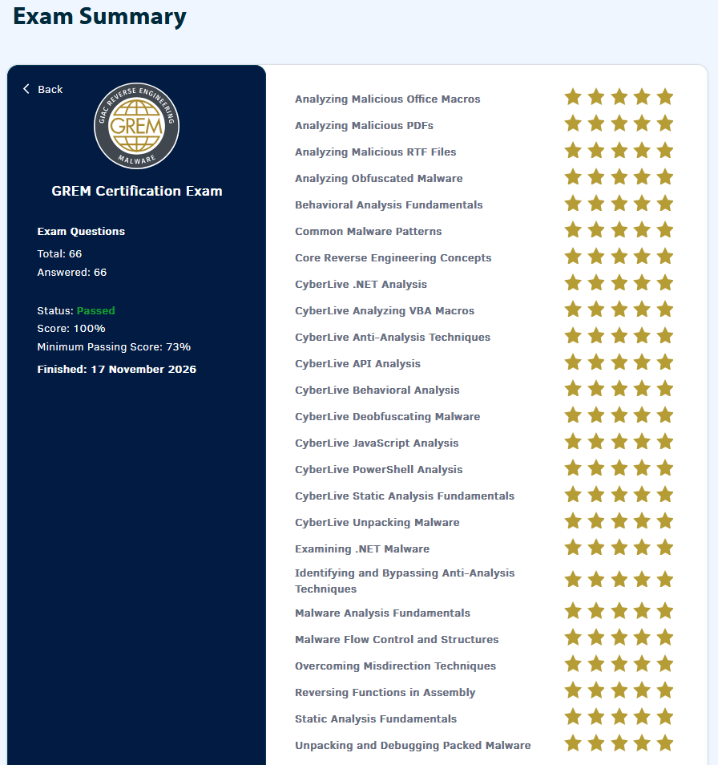

# 66 Questions, Zero Wrong Answers - How I got 100% on GREM

On November 17th, 2026, I passed the [GIAC Reverse Engineering Malware (GREM)](https://www.giac.org/certifications/reverse-engineering-malware-grem) certification exam with a score of 100%. I started [SANS FOR610](https://www.sans.org/cyber-security-courses/reverse-engineering-malware-ai-assisted-analysis) on October 26th, making the time from starting the course to taking the exam just over three weeks.

In this article, I’ll cover my background going into the course, my experience with the material, and how I prepared including how I built an index.

**Disclaimer - The course overview stays within publicly available SANS descriptions and excludes exam questions and lab solutions.**

## **My Starting Point**

Before taking `FOR610` I had some experience reversing `32-bit` Windows Portable Executables (PE) and reversing `16-bit` RISC MSP430 binaries. However, I had limited exposure to self-defending / anti-analysis malware samples, especially `.NET` and multi-technology malware.

Most of my previous experience involved using `PeStudio` and `IDA Pro`, but `FOR610` gave me a chance to practice in `Ghidra` and I plan to write some `java`/`python` scripts to extend its functionality with `MSP430` Microcontrollers.

## Why I Pursued GREM

Simple, a friend once asked me, "Do you want to be ordinary, or do you want to be exceptional?"

In the field of red teaming, there is no room for complacency. I'm driven by a desire to continuously build upon my skills and improve my abilities to produce the best work I can. I want to contribute original research to the field; A novel reflective loading technique, an evasive C2 stager, an improvement to `CET`/`CFI` Counterfeit Object-Oriented Programming bypass. Earning `GREM`, was just another step on that journey.

## **My Score and My FOR610 experience**

The five main subject areas I studied were:

* Malware Analysis Fundamentals
* Reversing Malicious Code
* Beyond Traditional Executables
* In-Depth Malware Analysis
* Examining Self-Defending Malware

As you can see above, I was able to successfully answer all the multiple choice and CyberLive questions. Most of my previous static code analysis experience was in `IDA Pro`, so `FOR610` gave me an opportunity to become more comfortable using `Ghidra`. I also was able to expand my proficiency in unpacking and deobfuscating `x86 and x64 PE` malware in `x64dbg` and `.NET` malware in `dnSpy`.

I was first introduced to anti-analysis and anti-debugging techniques by a college professor, and shortly after the first paper that really got me interested in digging deeper was Tyler Shields’s [_Anti-Debugging – A Developers View_](https://www.secnews.pl/wp-content/uploads/2011/05/whitepaper_antidebugging.pdf), published by Veracode. `FOR610` dives into these techniques and others, teaching exactly how to identify, and bypass them.

## Course and Index Strategies

Below I outline my exact strategy for both taking the course, and for indexing.

### Course Timeline

`Week 1` - Build Familiarity

* Take the OnDemand Course
* Watch the videos
* Follow along in the labs
* Take no notes

`Week 2` - Solidify Understanding

* Index each book
* Redo the labs while working through each book

`Week 3` - Exam Preparation

* Take practice test
* Reread each book
* Redo the labs a final time.

And finally -> `Ace Exam`

### Index Format

I follow the typical SANS index format for the most part, using a page, term, and definition table, however I also add a cross reference column to tie terms together. I find this helps me both to logically understand how concepts build on each other and also helps me to find other pages that may reference material in the question during exams.

| Pages         | Term      | Definition                                                                                                                                                                                    | Cross-Reference |
| ------------- | --------- | --------------------------------------------------------------------------------------------------------------------------------------------------------------------------------------------- | --------------- |
| (Book#.Page#) | imagebase | header field in pe format which contains the virtual address where the executable wants to be loaded into memory. when aslr is turned on windows ignores this and randomizes the base address | PE format, ASLR |

## **What Helped Most**

When it comes to SANS courses / GIAC certifications, I strongly believe the content is almost always generally simple enough to understand on the first pass, and with my existing reversing background, I found much of the material approachable on the first pass. The second pass was where I consolidated that understanding: I worked through each book carefully, built my index, and connected related concepts through cross-references.


[Credly Badge](https://www.credly.com/badges/eb7de098-e48c-44de-a09d-c77c62ea45ce/public_url)

